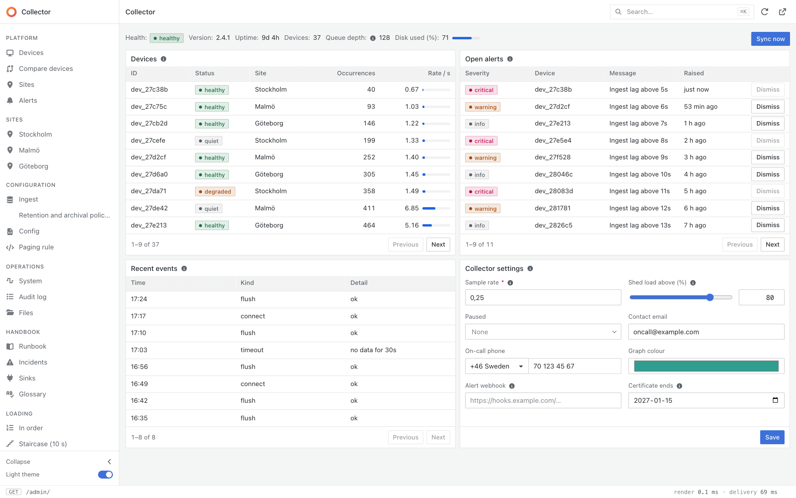
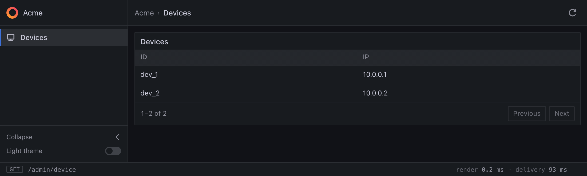
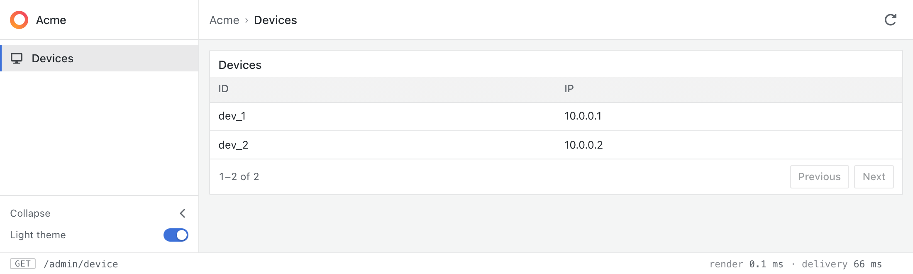

# webui

[](https://pkg.go.dev/github.com/Olian04/webui/pkg/webui)

Build admin panels in pure Go. Declare your pages and webui serves a fast,
server-rendered UI, with **no HTML, CSS or JavaScript to write**.

- **Zero frontend.** Declare pages, tables, forms and actions as plain Go values.
- **Type-safe.** The compiler checks your links and arguments.
- **Batteries included.** Sorting, filtering, pagination, search, validation, uploads and dark mode.
- **Progressive enhancement.** Every control is a real link or form, so it works without
  JavaScript.
- **Hypermedia-driven.** A hypermedia-driven application (HDA) built on HATEOAS
  (Hypermedia as the Engine of Application State): the server answers with HTML that carries
  every action available in that state.
- **Secure by default.** CSRF protection, a strict content security policy, and guards per
  page and per action.

<picture>
  <source media="(prefers-color-scheme: dark)" srcset="docs/images/overview-dark.png">
  
</picture>

That is the demo's landing page, `go run ./cmd/demo`, in light or dark as the viewer's
theme is: [`cmd/demo/overview.go`](cmd/demo/overview.go), about 120 lines of Go with
their comments, and no HTML, CSS or JavaScript. The tables page, sort and filter, the
form checks what it is given, and the buttons are there for the people who may use them.

## Install

```sh
go get github.com/Olian04/webui@latest
```

webui needs Go 1.27 or later. Import the package it exports (the editor's optional
language services are separate imports, see the package documentation):

```go
import "github.com/Olian04/webui/pkg/webui"
```

## Quick start

A page with a table of devices:

```go
package main

import (
 "context"
 "log"
 "net/http"

 "github.com/Olian04/webui/pkg/webui"
)

type Device struct{ ID, IP string }

// An accessor is written once, and is a column in a table and an input in a form.
var (
 ID = webui.String[Device]{Label: "ID", Load: func(d Device) string { return d.ID }}
 IP = webui.String[Device]{Label: "IP", Load: func(d Device) string { return d.IP }}
)

var Devices = webui.Page[webui.NoArgs]{
 Path: "/device",
 Nav:  webui.Nav{Label: "Devices", Icon: "display"},
 Body: webui.Table[Device]{
  Title: "Devices",
  // Rows is every row. The library sorts, filters and pages them.
  Rows: func(context.Context) ([]Device, webui.Loaded) {
   return []Device{{"dev_1", "10.0.0.1"}, {"dev_2", "10.0.0.2"}}, webui.Ready()
  },
  Columns: []webui.Accessor[Device]{ID, IP},
 },
}

func main() {
 app := webui.App{Brand: webui.Brand{Name: "Acme"}, Pages: webui.Pages{Devices}}

 // Compile checks the declaration and returns an http.Handler.
 http.Handle("/admin/", app.MustCompile("/admin"))
 log.Fatal(http.ListenAndServe(":8080", nil))
}
```

Run it and open <http://localhost:8080/admin/device>:

### Dark mode



### Light mode



That is a sidebar, a breadcrumb, and a table whose columns all sort and filter, with the
state kept in the address so a copied link reproduces the view. Give a page a `Search`
and the top bar gets a search box. Add a `Form` for an editable page, a `Link` to open a
row, and a `Guard` to say who may see it.

webui does not authenticate. Mount the handler behind your own login.

## Try the full demo

The repository has a larger demo, an imaginary telemetry collector, that shows the
library end to end:

```sh
git clone https://github.com/Olian04/webui && cd webui
go run ./cmd/demo                    # http://localhost:7689/admin/ (you choose a viewer or an editor first)
go run ./cmd/demo -accent '#1f7a6d'  # override the theme's accent colour
go run ./cmd/demo -broken            # the failed-to-compile page: three pages, broken in three ways
```

## Documentation

The full documentation is on pkg.go.dev, with runnable examples:

**<https://pkg.go.dev/github.com/Olian04/webui/pkg/webui>**

It covers pages and their arguments, layouts and toolbars, accessors and file uploads,
tables (paging, sorting, filters, export and caching), forms, validation and text rules,
controls that a visitor may not use, outcomes (success, warning, failure, rejection and
where to go next), links between pages, search, code editors, diffs and Markdown,
theming, refusals and compile errors, logging, metrics, and security.

## What the library stores in the browser

webui sets one cookie, keeps three values in `localStorage` and two in `sessionStorage`.
It uses nothing else on a visitor's device: no analytics, no tracking, no identifier,
and the scripts, styles and fonts it ships are served by your own app and call no other
host.

| What | Kind | Set when | Holds | Lasts |
| ---- | ---- | -------- | ----- | ----- |
| `webui_flash` | Cookie, `HttpOnly`, `SameSite=Lax`, `Secure` over TLS, path is the mount prefix | A visitor's action is accepted (a `Success` or a `Warning`) | The message of the toast shown on the next page (up to 300 bytes, and no more than that action produced) | 60 seconds, and cleared as soon as a page shows it |
| `webui.theme` | `localStorage` | A visitor flips the light/dark theme switch (an icon button in the top bar) | `light` or `dark` | Until the visitor changes it or clears site data |
| `webui.sidebar` | `localStorage` | A visitor collapses the sidebar | `collapsed` | Until the visitor expands it or clears site data |
| `webui.sidebar.width` | `localStorage` | A visitor drags the sidebar's edge, or moves it with the arrow keys | The width in pixels, a whole number from 180 to 480 | Until the visitor resets it (Enter, or a double click on the edge) or clears site data |
| `webui.sidebar.scroll` | `sessionStorage` | A visitor leaves a page | How far the sidebar's list was scrolled, in pixels, so that it is where it was on the next page | Until the tab is closed |
| `webui.content.scroll` | `sessionStorage` | A visitor leaves a page | The path of the page (never its query) and how far its content was scrolled, in pixels, so that a tab, a sort or a page of a table that is followed on the same page does not take the reader back to the top. It is put back only on a page with the same path | Until the tab is closed |

A form that is refused is not redirected: the POST is answered with the page, the form
drawn again with what the visitor typed and what was refused, with the status 422. What
was typed is in that response and nowhere else: it is not in a cookie, not in the
address, and not kept on the server, so there is nothing to lose behind a load balancer
and nothing to expire. The browser asks "send the form again?" if the page is reloaded,
which is right, since a refusal did nothing. An accepted action is redirected with a 303
so that a reload does not repeat it, and its toast rides the cookie above.

The three preferences are read by a small script before the first paint, so the page
does not flash the wrong theme or a sidebar of the wrong width. They stay in the browser
and are never sent to the server. A visitor who has never touched the controls has no
`localStorage` entry at all. The scroll position is for the tab, not for the browser,
and each holds no more than a number, with the path of the page the content's is for.

Two things are yours, not webui's:

- **Sign-in.** webui does not authenticate, so the session or token cookie of the login you
  mount it behind is your own to account for.
- **Pictures from other origins.** A page that shows Markdown with `TrustedOrigins` lets the
  visitor's browser fetch pictures from them, which tells those hosts the visitor's address.

Under the EU's ePrivacy rules (Article 5(3)), storing information on a visitor's device
needs consent unless it is strictly necessary for a service the visitor asked for.
Whether the three items above fall under that exemption is for you to decide as the
operator, since you are the one who deploys the app; the table is there so that you can
decide it, and name them in your privacy notice. This is not legal advice.

## Building with an AI agent

The repository ships a skill that teaches a coding agent to build with webui: the
mental model, the order to work in, how to handle authentication, and when the library
cannot do something. It names almost none of the API. It tells the agent to read the
documentation for the version your `go.mod` pins (`go doc` reads it from the module
cache), so it does not go stale when the library changes.

It is in the open [Agent Skills](https://agentskills.io) format, so it works in Claude
Code, Cursor, Codex, Gemini CLI and other agents. Pick the way that fits yours.

**Claude Code**, as a plugin:

```text
/plugin marketplace add Olian04/webui
/plugin install webui@olian04
```

**Any agent**, with the [`skills`](https://github.com/vercel-labs/skills) CLI, which
installs it for the agents it finds on your machine:

```sh
npx skills add Olian04/webui
```

**By hand**, copying it from the module cache so it matches your version, into the
folder your agent reads skills from (`.claude/skills` for Claude Code,
`.cursor/skills` for Cursor, or `.agents/skills`, which several agents read):

```sh
mkdir -p .agents/skills
cp -r "$(go list -m -f '{{.Dir}}' github.com/Olian04/webui)/skills/webui" .agents/skills/
chmod -R u+w .agents/skills/webui
```

Or read it at [`skills/webui/SKILL.md`](skills/webui/SKILL.md).

---

## Developing webui

This half is for people changing the library.

### Layout

| Path                  | Role                                                                                                                                                                         |
| --------------------- | ---------------------------------------------------------------------------------------------------------------------------------------------------------------------------- |
| `pkg/webui`           | The public API: the declaration types, and `Compile`, which validates them and lowers them to the runtime. Its package documentation and examples are what pkg.go.dev shows. |
| `internal/ir`         | The handoff between the declaration and the runtime. Plain data and closures with the types erased: no transport, no generics.                                               |
| `internal/args`       | Encoding and decoding a page's path and query arguments, from the struct's fields and `webui` tags.                                                                          |
| `internal/rules`      | The pattern syntax that Go and a browser read alike, the text rules, the check of an uploaded file by what it holds, and the server-side check of a field's constraints.                                                                                                          |
| `internal/tablequery` | Filtering, sorting, paging and finding rows held in memory, for `Table.Rows` and `SearchRows`.                                                                                              |
| `internal/runtime`    | The compiled app: routes, the request pipeline (a slow page is streamed in order), actions (an accepted one is redirected, a refused form is answered with the page and a 422), flash, search, export, and `Open`.                      |
| `internal/render`     | The IR and loaded data as HTML, and the assets. `templates/components` is the component library.                                                                             |
| `internal/favicon`    | Scales `Brand.Logo` into the favicons, and an image into a thumbnail for `webui.Thumbnail`.                                                                                  |
| `internal/phone`      | Countries, calling codes, how a national number is spaced, and E.164; the options of a phone field's selector are drawn from it.                                                          |
| `internal/editorctx`  | Reads an editor's `Context` folder (declaration files, compiler options, schemas) for its language service.                                                                  |
| `internal/convert`    | List conversions between the declaration, the IR and the response.                                                                                                           |
| `internal/assetserve` | Serves the files that never change: a hash in the name, a year's cache, compression and 304.                                                                                 |
| `internal/metrics`    | The Prometheus metrics behind `App.Metrics`: it collects and serves none, and reuses collectors that exist.                                                                  |
| `internal/rank`       | How well a search result matches what was typed: the score that orders the results.                                                                                          |
| `internal/markdown`   | Markdown to HTML for `Markdown`, with goldmark: no raw HTML, links to http, https and mailto only, images as links unless the origin is trusted.                                                          |
| `internal/textdiff`   | The unified diff that a `Diff` shows without script.                                                                                                                         |
| `pkg/monaco`          | Optional language services for the editor, one package each (`json`, `css`, `html`, `typescript`). Importing one embeds its worker and offers it to editable editors.          |
| `tools/monaco`        | The build of the embedded Monaco editor, with `make monaco`. It needs node, and its output (`internal/render/assets/monaco`, `pkg/monaco/*/worker`) is committed.             |
| `test`                | Integration tests, which import `pkg/webui` only.                                                                                                                            |
| `skills/webui`        | The skill that teaches an agent to build with the library. It points at the documentation for the version in use and names almost no API; `test/skill_test.go` checks that. |
| `.claude-plugin`, `.cursor-plugin` | Packaging for the skill: a Claude Code marketplace, which installs only `skills/webui` and not the source around it, and a Cursor plugin, which takes the repository root. |
| `test`, `test/util/assert`| The tests that use only the public package, and the assertions that all of the tests use.                                                                                    |
| `cmd/demo`            | The runnable demo. It is not part of the API.                                                                                                                                |

Dependencies point one way: `pkg/webui` depends on `internal/*`, never the reverse, and
`test` never imports `internal`. [`docs/AGENTS.md`](docs/AGENTS.md) is the full set of
conventions, and is the source of truth when advice conflicts.

A declaration becomes a page in four steps. `pkg/webui` validates it, collecting every
problem, and lowers it, which is the one place type parameters are erased, into
`internal/ir`. `internal/runtime` turns that into routes and a request pipeline
(decode the arguments, run the page's Guard, load, render; for a POST: parse, rules,
bind, Guard, Run). `internal/render` renders the result with
[templ](https://templ.guide) components and serves the stylesheet, scripts and icon
font.

### Working on it

```sh
make help       # the targets
make generate   # regenerate the *_templ.go files from the .templ sources
make test       # generate, then go test -race -shuffle=on
make lint       # generate, vet, verify modules, govulncheck, golangci-lint
make run        # build and run the demo
```

The generated `*_templ.go` files are committed, so the module builds for anyone who
imports it. Run `make generate` after editing a `.templ` file; CI fails if they are
out of date. The icon font and its class list are generated from a Font Awesome Free
download by `internal/render/assets/fontawesome_gen.go`; see
[`docs/AGENTS.md`](docs/AGENTS.md).

### Tests

Tests for the public API are integration tests in `test`: they compile an app and
make requests to it, and import `pkg/webui` only. Unit tests for an internal package
sit beside the code in the same package. The runnable examples in `pkg/webui` are
tests too, so the documentation on pkg.go.dev cannot drift from the code.

Code that only a test uses does not belong in the library. If nothing reachable from
the public API needs it, it is deleted, or moved into the tests.

### Documentation authoring

| Where                                                  | What                                                                                                                                                              |
| ------------------------------------------------------ | ----------------------------------------------------------------------------------------------------------------------------------------------------------------- |
| `pkg/webui/doc.go`, and every exported identifier      | The documentation for users, which pkg.go.dev renders. Write it as complete sentences that start with the name, and put runnable examples in `example_*_test.go`. |
| [`docs/design-decisions.md`](docs/design-decisions.md) | Why the library is shaped as it is, and what each decision costs. Read it before changing the API.                                                                |
| [`docs/design.md`](docs/design.md)                     | The visual language: tokens, metrics, components and states.                                                                                                      |
| [`docs/design-mapping.md`](docs/design-mapping.md)     | Which declared type produces which design element, and where the two disagree.                                                                                    |
| [`docs/AGENTS.md`](docs/AGENTS.md)                     | Layout, dependency direction and Go conventions, for people and tools.                                                                                            |

### The demo

The demo is a static configuration that shows the whole library; each file has its own
corner, and the tests beside it (`cmd/demo/*_test.go`, one file for each part of the
demo) pin what it shows.

| File                    | Shows                                                                                                                                                                                                                                                                                                                                |
| ----------------------- | ------------------------------------------------------------------------------------------------------------------------------------------------------------------------------------------------------------------------------------------------------------------------------------------------------------------------------------ |
| `devices.go`            | the list: a table with paging, sorting, column filters (multi-select, range, text) and row links; an `Int` with a `Format` (bytes read "1.5 GiB" and sort and filter as the number); `Export` on a `Load` table (CSV and JSON from the footer; `alerts.go` has it on `Rows` and `system.go` on a `Feed`); a `Toolbar` of a link and a button, both left out for a viewer, and so the toolbar                                                                                                                                                                                                                                                                                                                                                                                                                                                                                                                                                                                                                                                                                                             |
| `devices.go`, a device  | a detail page whose `Search` finds its devices from the search box; a `Help` tip on fields and a `Crumb` that reads a device by its address and not its id; a device that is not there is a 404 with a link back (`NotFound(...).WithLink(...)`); a form in tabs beside a table; a path and query argument (`?minutes=`)                                                                                                                                                                                                                                                                                                                                                                                                                                                                                                                                                                                                                                                                                                                                                                                 |
| `devices.go`, a new device| a form that makes a device, and a device form that returns to whichever page opened it, with no code; `Placeholder`, `Group`, a `Timestamp`, a `Multiline` text area; a `Select` that is edited, one value and several (`Multi`), one whose options are read when the page is asked for (`LoadOptions`); a rejection with `Reject`, and a `Success` that goes `Then` to the device it made                                                                                                                                                                                                                                                                                                                                                                                                                                                                                                                                                                                                                                                                                                               |
| `compare.go`            | arguments that are lists: a `[]string` is a query parameter that repeats (`?device=a&device=b&site=Malmö`), each element parsed on its own, the page's links keeping every one, and its address the whole of what it shows |
| `files.go`              | the rest of a path, `{path...}`, as a `[]string` (a file browser at any depth, a breadcrumb for each segment), a row `Link` that adds a name to the list, a `PageID` constant to break the initialization cycle between a page and the table in it, and a `Markdown` whose links, such as `/files/logs`, are paths in the app |
| `sites.go`              | a nested path with a parent breadcrumb, a sidebar entry for each site from `NavEntries`, two stateful tables on one page, each named in the address by its title, a detail page whose `Search` is `SearchRows`, so its sites are found from the search box                                                                                                                                                  |
| `alerts.go`             | row and bulk actions, `RolePrimary` and `RoleDestructive`, a `Confirm` that asks first in a native `<dialog>`, a row `Link` to an alert page (a path argument) whose device table links on with a query argument, a form of read-only fields with one action that goes `Back` when someone else acknowledged it first, a `URL` link and a `Datetime` column (read as "53 min ago" by its `Format`, sorted and filtered as a moment), gating by role: a viewer is not offered the actions at all, with no checkbox column or bar, and an editor sees `Dismiss` disabled, with its reason, for a critical alert (`webui.Disabled`)                                                                             |
| `settings.go`           | rules (`Required`, length, text rules, a pattern, bounds), a `Secret` API key, `Email`, `Phone`, `Website` and `ColorPicker`, a `DateOnly` timestamp, `Float`, a writable `Slider`, `OptionalInt`, `OptionalSlider` and a three-valued `Bool`, a save that `Stay`s on the form; an entry with no icon (the Retention page's: its initial in the collapsed sidebar) |
| `uploads.go`            | `File`: a logo (an image of at most 1 MiB) and a certificate (a PDF a visitor may remove), checked by what they hold and not by their names, kept in memory by the demo and served by its own route as a download, with `nosniff` and the sniffed type; `ReadTimeout` on the server; with script a drop zone, a small picture of the image that is chosen and a thumbnail (`webui.Thumbnail`) of the one that is stored, each opening the full image in a dialog only when clicked, and the size and kind said before the request is sent; and `FileUpload`: a firmware image of up to 2 GiB in a panel of its own, with two choices beside it (the `Fields` of a `FileUpload[M]`, checked before the file is read), handed to `Receive` as it arrives and hashed as it is read, so that none of it is held, with several files or a folder sent one after another, each with a progress bar and a result of its own (the server answers each in HTML), in memory or on disk, and disabled, with its reason, for a viewer |
| `overview.go`           | the landing page (`Path: "/"`, reached from the brand and the first breadcrumb): the one that shows the library all at once, the screenshot at the top of this file. A `Toolbar` whose forms load the system's values and the sync job (read-only, the sync one refreshing itself while it goes on), with a button at the right edge that only editors are offered, and a `Split` of two paged tables, a table of another model and a form, each declared as on a page of its own|
| `system.go`             | a read-only form (no `Submit`), a read-only `Select` as a badge and a read-only `Slider` as a bar, a page `Guard` that refuses viewers, a `Feed` table, paged by a cursor, `Nav.Icon`                                                                                                                                                                                                                         |
| `rule.go`               | an `Editor` in TypeScript with the language service imported in `main.go` (the largest worker, so the one to leave out for a small program): the types are checked as you type, and the seed text has three errors to find; its `Context` is an embedded folder that gives the service the types of the host (`rule.d.ts`) and a `tsconfig.json`; a viewer reads it highlighted and is sent no service |
| `config.go`             | an `Editor` (JSON, saved with a `Submit` that only editors may use) over a text, a `Diff` of the saved text against the deployed one, and the JSON language service, which is one import in `main.go`, checking the text against a schema from the same embedded `Context` folder |
| `handbook.go`           | four `Markdown` pages, embedded `.md` files, that link to each other and to other pages with paths such as `/config` (given the mount prefix), and show tables, a checklist and coloured code blocks, where raw HTML in the text is never rendered |
| `metrics.go`            | `App.Metrics`: the app counts what it does as Prometheus metrics and serves none of it; the program has a registry of its own, with Go metrics, and serves it at `/metrics` |
| `layout.go`             | layouts in combination: the rows of a `Split` (equal within a row, independent between rows), a main panel with a rail (a `Stack` in a `Split`), columns in columns (a `Split` in a `Split`), `Tabs` side by side and in a `Split`, strips of three, six and sixteen tabs that scroll sideways when they do not fit, five layouts deep, an `Editor` beside a `Diff` with a runbook in a tab, and a `Markdown` text beside live panels |
| `loading.go`            | the Loading section: a page with a slow panel is sent as it is built, in order, with a spinner and a status bar that says it is still arriving. A ten-panel staircase (one more second each), `Tabs` that read only the tab you follow (a panel outside them keeps the moment it was read at), panels in order, layouts inside layouts, panels that fail, a page built whole (an editor), a refusing `Guard` and a page that answers at once |
| `auth.go`               | the surrounding authentication: a signed session cookie chosen at `/login` (a viewer or an editor), read by the Guards from the request's context                                                                                                                                                                                    |
| `main.go` and `logo.go` | `Brand.Logo`, `Theme.Accent`, `ExternalLinks`, `Logger` and the metrics registry, `Compile` and the compile-error page (`-broken`), the editor's language services imported, and an `http.Server` with `ReadTimeout` |
| `service.go`, `format.go`, `context.go`| the demo's own data, formats and embedded files (`context/`, `handbook/`), which the other files read                                                                                                                |

### Conventions

- **Commits** are [Conventional Commits](https://www.conventionalcommits.org) with a
  capital after the colon (`feat(webui): Add ...`), and `!` for a breaking change.
  Work happens on a branch, not on `main`.
- **Changing the public API** is a decision, not a side effect. Prefer behaviour the
  library infers or owns over a hook the user implements, prefer what the compiler
  can check over what `Compile` has to, and keep the surface small.
- **Everything works without JavaScript.** The script adds speed and conveniences
  and nothing else; a feature that needs it is not finished.

### Releasing

Releases are cut from the **Release** workflow (Actions, *Run workflow*), which asks
for a version, tags the commit, and publishes the release with GoReleaser. The
version is the tag, so it has to be one that Go accepts as a module version: `vX.Y.Z`,
or `vX.Y.Z-N` for the Nth prerelease before it, with the `v` and no leading zeros
(`v1.0.0-4`, not `1.0.0-4`). The workflow refuses anything else, and a major version
of 2 or more until the module path ends in `/v2` and so on. Nothing is built: webui is a
library, and consumers fetch the tag with `go get`.
